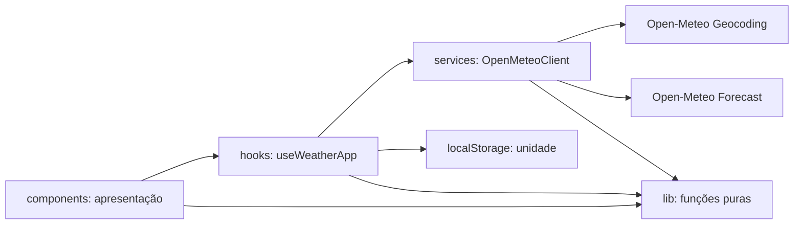
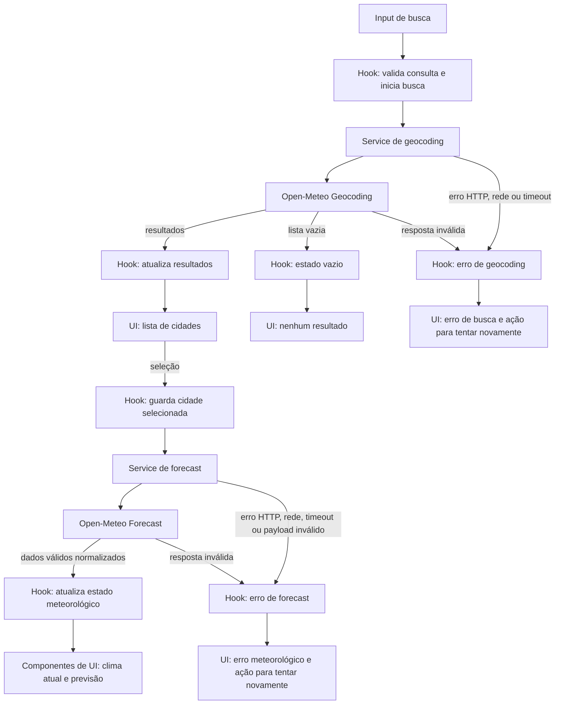

# Plano Técnico — Aplicação de Previsão do Tempo

## Architecture

Aplicação SPA sem backend próprio. A camada de interface é responsável pela apresentação; um hook local coordena busca, seleção, consulta e preferências; um serviço isola HTTP, validação e normalização do Open-Meteo. Funções puras tratam conversão de temperatura e códigos meteorológicos.



Uma única chamada ao endpoint Forecast solicita clima atual e previsão diária; isso mantém as duas seções coerentes e reduz chamadas. Geocoding é uma chamada separada por busca válida. Não introduzir estado global, backend, cache remoto ou biblioteca de data fetching para este escopo.

## Tech Stack

| Área | Decisão | Justificativa |
| --- | --- | --- |
| Linguagem e build | TypeScript strict, Vite | Já configurados; build existente executa `tsc -b` antes do bundle. |
| Interface | React 19 | Dependência existente e adequada à SPA de uma tela principal. |
| Estilos | Tailwind CSS 3 | Já instalado e consistente com a stack do projeto. |
| HTTP | `fetch` nativo | Open-Meteo não exige chave; não há necessidade de adicionar cliente HTTP. |
| Estado | `useReducer` encapsulado em hook | Mantém transições relacionadas em um só lugar, sem biblioteca global. |
| Persistência | `localStorage` somente para unidade | Requisito explícito; não persistir cidade, dados ou informação pessoal. |
| Testes | Vitest, Testing Library, Playwright | Já configurados para unitários/componentes e E2E. |
| Qualidade | Biome | Lint e formatação já configurados. |

Não adicionar dependências para ícones, datas, estado ou requests sem necessidade demonstrada durante a implementação.

## Project Structure

Estrutura proposta; `src/` e `tests/` ainda precisam ser criados.

```text
src/
  main.tsx
  App.tsx
  components/
    CitySearch.tsx
    CurrentWeather.tsx
    ForecastList.tsx
    TemperatureUnitControl.tsx
    RequestStatus.tsx
  hooks/
    useWeatherApp.ts
  services/
    openMeteoClient.ts
  lib/
    searchQuery.ts
    temperature.ts
    weatherCode.ts
    dateTime.ts
  types/
    weather.ts
tests/
  unit/
    services/openMeteoClient.test.ts
    lib/searchQuery.test.ts
    lib/temperature.test.ts
    lib/weatherCode.test.ts
    lib/dateTime.test.ts
    hooks/useWeatherApp.test.ts
  components/
    CitySearch.test.tsx
    WeatherViews.test.tsx
  e2e/
    weather-app.spec.ts
```

### Responsabilidades e dependências entre camadas

- **`components/` — apresentação:** componentes React recebem dados, estados e callbacks por props e cuidam de renderização, interação e acessibilidade. Não fazem `fetch`, não conhecem o formato bruto da Open-Meteo e não mantêm cópias paralelas do estado da aplicação.
- **`hooks/` — orquestração e estado:** `useWeatherApp` coordena busca, seleção, consulta, atualização manual, concorrência, loading/erro/vazio e preferência de unidade. Chama contratos do serviço e entrega estado/ações prontos à tela; mantém a política de estado fora dos componentes.
- **`services/` — acesso a dados:** `openMeteoClient` constrói URLs e parâmetros, executa `fetch` com timeout/cancelamento, valida o payload externo e converte-o para os tipos internos. Não contém estado React nem lógica de apresentação.
- **`lib/` — funções puras reutilizáveis:** validação da consulta, conversão/formatação de temperatura, mapeamento de códigos WMO e operações de data/hora sem I/O ou dependência de React. Entradas e saídas explícitas tornam as regras previsíveis.
- **`types/` — contratos compartilhados:** tipos do modelo interno e dos erros usados entre camadas. A resposta externa não deve atravessar o serviço até a interface sem validação e normalização.

O fluxo principal é `components → hooks → services → Open-Meteo`; `lib` fornece funções puras às camadas que precisem delas, e `types` define os contratos. As dependências devem apontar para dentro desses contratos: componentes não importam serviços, serviços não importam hooks/componentes, e `lib` não depende de React, rede ou estado global. Não criar uma camada de repositório ou domínio separada enquanto houver somente uma fonte e um fluxo.

### Como a separação facilita os testes

- **`lib`:** testes unitários diretos de entradas, saídas e limites, sem mocks de rede ou renderização.
- **`services`:** testar URLs, parâmetros, validação e normalização com `fetch` mockado; cobrir falhas HTTP, rede, timeout e payload inválido sem depender do provedor externo.
- **`hooks`:** testar transições de estado e orquestração substituindo o cliente por um mock, incluindo respostas fora de ordem e erro/retentativa.
- **`components`:** testar renderização, acessibilidade e interação por roles/labels com estado e callbacks controlados, sem acoplar os testes à API.
- **Fluxo integrado/E2E:** verificar o caminho busca → seleção → previsão e as principais recuperações com as rotas externas interceptadas.

Assim, cada suíte valida uma responsabilidade em isolamento, enquanto os testes de fluxo cobrem a integração sem tornar os testes unitários lentos ou dependentes da disponibilidade da Open-Meteo.

## Data Model

Contratos TypeScript conceituais, não implementação final. Respostas externas devem ser validadas e convertidas para estes tipos antes de chegarem à UI.

```ts
export type TemperatureUnit = "celsius" | "fahrenheit";

export interface City {
  id: string;
  name: string;
  region: string | null;
  country: string | null;
  latitude: number;
  longitude: number;
}

export interface WeatherCondition {
  code: number;
  labelPtBr: string;
}

export interface CurrentWeather {
  temperatureC: number | null;
  apparentTemperatureC: number | null;
  condition: WeatherCondition | null;
  relativeHumidityPercent: number | null;
  windSpeedKmh: number | null;
  observedAt: string | null; // instante ISO-8601 normalizado pelo serviço
}

export interface DailyForecast {
  date: string; // YYYY-MM-DD no fuso da localidade
  condition: WeatherCondition | null;
  temperatureMinC: number | null;
  temperatureMaxC: number | null;
  precipitationProbabilityMaxPercent: number | null;
}

export interface WeatherReport {
  city: City;
  timeZone: string;
  fetchedAt: string; // instante ISO-8601 em que a resposta válida foi recebida
  current: CurrentWeather;
  days: DailyForecast[]; // até cinco itens; pode haver cobertura parcial
}

export type RequestErrorCode =
  | "network"
  | "timeout"
  | "http"
  | "invalid-response";

export interface RequestError {
  code: RequestErrorCode;
  messagePtBr: string;
}

export interface OpenMeteoClient {
  searchCities(query: string, signal?: AbortSignal): Promise<City[]>;
  getWeather(city: City, signal?: AbortSignal): Promise<WeatherReport>;
}
```

`City.id` é identificador estável no cliente, derivado do ID do provedor quando disponível ou das coordenadas. `null` representa campo ausente; zero é um valor válido e não deve ser usado como fallback. Temperaturas são mantidas em Celsius no modelo interno; conversão e arredondamento a uma casa decimal ocorrem na apresentação. `weatherCode.ts` mapeia códigos WMO para rótulos pt-BR e fornece fallback para códigos desconhecidos.

## Data Flow



1. A pessoa digita uma consulta. Remover espaços externos; rejeitar menos de 3 ou mais de 100 caracteres sem chamar a API.
2. `useWeatherApp` inicia geocoding, expõe loading e associa a resposta a um identificador de requisição. Apenas a busca mais recente atualiza resultados.
3. Selecionar um resultado guarda a `City` em memória e chama `getWeather(city)` com latitude/longitude.
4. O serviço solicita dados atuais e diários em uma resposta Forecast, valida campos e normaliza unidades, datas e horário para `WeatherReport`.
5. A interface renderiza clima atual e até cinco dias. Campos ou datas ausentes são identificados, sem inferir valores.
6. Alternar unidade atualiza a apresentação de todas as temperaturas e grava a preferência no `localStorage`. O modelo permanece em Celsius.
7. “Atualizar” refaz a consulta da localidade ativa. Não há atualização automática nem persistência da cidade.

## External APIs

Sem API key, autenticação ou backend intermediário. Respeitar termos e limites de uso publicados pelo Open-Meteo; não assumir SLA do provedor.

**Geocoding**

- Endpoint: `GET https://geocoding-api.open-meteo.com/v1/search`
- Parâmetros: `name` (texto já validado), `count=10`, `language=pt`, `format=json`.
- Exemplo de URL: `https://geocoding-api.open-meteo.com/v1/search?name=S%C3%A3o%20Paulo&count=10&language=pt&format=json`.
- Exemplo resumido de resposta:

```json
{
  "results": [
    {
      "id": 3448439,
      "name": "São Paulo",
      "latitude": -23.5475,
      "longitude": -46.63611,
      "admin1": "São Paulo",
      "country": "Brasil"
    }
  ],
  "generationtime_ms": 0.2
}
```

- Mapear cada item de `results` para `City`: converter `id` para `string`; `name` para `name`; `admin1` para `region`; `country` para `country`; e preservar `latitude` e `longitude` como números. Campos de região, país ou ID que não vierem devem seguir as regras do modelo (`null` para região/país; ID derivado das coordenadas se ausente). Ignorar metadados não usados, como `generationtime_ms`. Uma resposta válida sem resultados é normalizada para `[]`; resposta incompatível com o formato esperado é `invalid-response`.

**Forecast atual e diário**

- Endpoint: `GET https://api.open-meteo.com/v1/forecast`
- Parâmetros: `latitude` e `longitude` da cidade selecionada; `current=temperature_2m,relative_humidity_2m,apparent_temperature,weather_code,wind_speed_10m`; `daily=weather_code,temperature_2m_max,temperature_2m_min,precipitation_probability_max`; `temperature_unit=celsius`; `wind_speed_unit=kmh`; `timezone=auto`; `forecast_days=5`.
- Exemplo de URL: `https://api.open-meteo.com/v1/forecast?latitude=52.52&longitude=13.419&current=temperature_2m,relative_humidity_2m,apparent_temperature,weather_code,wind_speed_10m&daily=weather_code,temperature_2m_max,temperature_2m_min,precipitation_probability_max&temperature_unit=celsius&wind_speed_unit=kmh&timezone=auto&forecast_days=5`.
- `current` pede os valores meteorológicos da observação atual. `daily` pede séries diárias; cada posição de `daily.time` corresponde à mesma posição nos demais arrays. `timezone=auto` faz o provedor determinar o fuso pelas coordenadas e devolver as datas/horas locais; cinco dias atendem a previsão de hoje e dos quatro dias seguintes.
- Exemplo resumido de resposta (valores e unidades ilustrativos):

```json
{
  "latitude": 52.52,
  "longitude": 13.419,
  "utc_offset_seconds": 7200,
  "timezone": "Europe/Berlin",
  "current_units": {
    "time": "iso8601",
    "temperature_2m": "°C",
    "relative_humidity_2m": "%",
    "apparent_temperature": "°C",
    "weather_code": "wmo code",
    "wind_speed_10m": "km/h"
  },
  "current": {
    "time": "2026-06-15T12:15",
    "temperature_2m": 21.4,
    "relative_humidity_2m": 58,
    "apparent_temperature": 21.0,
    "weather_code": 2,
    "wind_speed_10m": 12.3
  },
  "daily_units": {
    "time": "iso8601",
    "weather_code": "wmo code",
    "temperature_2m_max": "°C",
    "temperature_2m_min": "°C",
    "precipitation_probability_max": "%"
  },
  "daily": {
    "time": ["2026-06-15", "2026-06-16", "2026-06-17", "2026-06-18", "2026-06-19"],
    "weather_code": [2, 3, 1, 61, 2],
    "temperature_2m_max": [24.1, 22.8, 25.0, 19.2, 23.6],
    "temperature_2m_min": [15.2, 14.7, 16.1, 13.4, 15.0],
    "precipitation_probability_max": [10, 25, 5, 65, 20]
  }
}
```

- Mapear `timezone` para `WeatherReport.timeZone` e a cidade selecionada para `WeatherReport.city`; gerar `fetchedAt` como instante ISO-8601 no cliente quando a resposta válida for recebida. Mapear `current.temperature_2m`, `apparent_temperature`, `relative_humidity_2m` e `wind_speed_10m` para os campos correspondentes de `CurrentWeather` em Celsius, percentual e km/h. `current.weather_code` alimenta `condition.code`; obter `condition.labelPtBr` pelo mapeamento WMO. Converter `current.time` de horário local em instante ISO-8601 para `observedAt`, usando o fuso/offset retornado (`timezone` e `utc_offset_seconds`).
- Para cada índice de `daily.time`, criar um `DailyForecast`: `time` → `date` (`YYYY-MM-DD` local), `weather_code` → `condition` (mesmo mapeamento WMO), `temperature_2m_min` → `temperatureMinC`, `temperature_2m_max` → `temperatureMaxC` e `precipitation_probability_max` → `precipitationProbabilityMaxPercent`. Descartar elementos depois dos cinco dias previstos.
- Validar os arrays e seus valores antes de normalizar. A ausência de um campo meteorológico opcional, incluindo probabilidade de precipitação, vira `null`, nunca zero; aplicar às temperaturas internas as unidades explicitamente solicitadas e conferidas em `current_units`/`daily_units`. As datas de `daily.time` permanecem datas locais, não timestamps UTC. Resposta estruturalmente malformada é `invalid-response`.

Cada request tem timeout de 10 s e suporta `AbortSignal`. O formato e as unidades retornados devem ser validados; não confiar em rótulos/unidades implícitos. Se a API alterar seu contrato, os testes do adaptador devem falhar sem propagar resposta incompatível à UI.

## State Management

Estado local em `useWeatherApp`, com `useReducer` para transições relacionadas:

- Busca: texto, resultados, estado `idle | loading | success | empty | error` e erro associado.
- Consulta meteorológica: cidade selecionada, relatório mais recente, estado `idle | loading | success | error` e erro associado.
- Preferência: `TemperatureUnit`, carregada de `localStorage`; valor ausente ou inválido resulta em Celsius.
- Concorrência: `AbortController` cancela a busca anterior quando possível; um request ID impede que respostas antigas atualizem o estado mesmo se o cancelamento não evitar a resposta.

Manter loading e erro independentes por fluxo. Em falha de atualização, manter a última resposta armazenada em memória com seu timestamp, mas indicar falha e nunca rotulá-la como consulta atual recém-sucedida. Não persistir cidade nem relatório.

## Error Handling

| Situação | Estado e resposta da interface |
| --- | --- |
| Entrada inválida | Validar localmente; nenhum request; instrução em pt-BR. |
| Geocoding com lista vazia | Estado `empty`; permitir editar e buscar novamente; não consultar Forecast. |
| Erro HTTP/rede | Estado `error` da operação afetada; mensagem recuperável e ação manual de retry. |
| Timeout | Abortar após 10 s; limpar loading e mostrar erro. Sem retry automático. |
| Resposta inválida | Não renderizar campos incompatíveis; informar indisponibilidade, registrar erro técnico sem dados pessoais. |
| Campo ausente | Mostrar demais campos; exibir “Indisponível” no campo faltante. Não substituir número ausente por zero. |
| Previsão com menos de cinco datas | Mostrar dias recebidos, indicar dias ausentes e que a previsão está incompleta. |
| Observação atual com mais de 2 h | Exibir horário e rótulo “Desatualizado”; não apresentá-la como atual. |
| Falha ao atualizar | Preservar relatório anterior em memória com timestamp, exibir falha da atualização e não alterar `fetchedAt`. |
| Unidade ausente/corrompida no storage | Usar Celsius; falha de `localStorage` não deve impedir consulta ou renderização. |

Erros de geocoding, clima atual e previsão devem ser diferenciados de uma resposta válida sem resultados. Erro de rede não apaga a seleção da cidade. Todas as mensagens visíveis são pt-BR.

## Testing Strategy

- **Funções puras (Vitest):** testar normalização e limites da busca; conversão Celsius/Fahrenheit e arredondamento, incluindo valores negativos e ausentes; códigos WMO conhecidos/desconhecidos; datas locais, fuso e classificação de observação acima de duas horas. Verificar entradas de fronteira e saídas exatas, sem mocks.
- **Services (Vitest):** mockar `fetch`; verificar URL/parâmetros dos endpoints, codificação de caracteres acentuados, mapeamento de geocoding/Forecast e validação de payload/unidades. Cobrir lista vazia, campos opcionais ausentes ou nulos, arrays diários incompletos, payload malformado, HTTP não-2xx, rede, timeout e cancelamento. Nenhum teste chama a API real.
- **Hooks (Vitest + Testing Library):** substituir `OpenMeteoClient` por mock e verificar transições loading/success/empty/error, seleção antes do Forecast, retry, unidade default/persistida e proteção contra respostas obsoletas. Confirmar que erro de atualização não altera a última consulta bem-sucedida nem apresenta dados antigos como recém-atualizados.
- **Componentes (Vitest + Testing Library):** usar estado/props controlados e cobrir loading, erro, vazio e sucesso para busca e painéis. Testar input 0/2/3/100/101 caracteres, seleção de homônimos, dados ausentes, previsão parcial, unidade e atualização; verificar roles/labels, teclado e anúncio de estado. Componentes não dependem de `fetch`.
- **E2E (Playwright):** interceptar rotas Open-Meteo com fixtures determinísticas. Validar busca → resultados → seleção → clima atual e cinco dias → Fahrenheit → reload preservando unidade → atualização manual. Cobrir busca inválida sem request, nenhum resultado sem chamada de Forecast, erro/timeout recuperável, resposta parcial e resposta fora de ordem.
- **Responsividade (Playwright):** verificar 320, 375 e 768 CSS px (mobile estreito, mobile comum e tablet), além de 1024 e 1440 px. No mobile de 375 px, executar ao menos o fluxo principal; em todos, verificar ausência de rolagem horizontal, corte de conteúdo essencial e controles inacessíveis. Preferir asserções de layout observáveis a snapshots visuais frágeis.
- **Requisitos não funcionais:** validar teclado e estados anunciados com testes automatizados e inspeção de acessibilidade; executar a matriz de navegadores RNF-04 conforme suporte do CI; medir p95 na rede controlada RNF-05. A disponibilidade do shell exige verificação sintética operacional a cada cinco minutos, separada dos testes E2E e da API externa.
- **Gates de entrega:** `pnpm lint`, `pnpm build`, `pnpm test` e `pnpm test:e2e`; nenhum gate é substituído por teste manual.

Usar fixtures determinísticas inspiradas no formato do provedor. Testes de funções, services, hooks e componentes não dependem de rede real; E2E também intercepta a API para evitar flakiness e dependência de disponibilidade externa. Cobertura percentual não substitui critérios de aceite: priorizar estados, falhas e limites especificados.

## Risks & Trade-offs

| Decisão | Alternativas consideradas | Trade-off e justificativa |
| --- | --- |
| React local + `useReducer` encapsulado em hook | Vários `useState`; Context/Redux ou outra biblioteca global | O reducer centraliza transições e basta para uma tela/fluxo. Tem mais estrutura que `useState`, mas evita estado global e dependências; reavaliar se surgirem múltiplos consumidores. |
| `fetch` nativo no service | Axios ou biblioteca de requests/cache | Menos dependências e controle direto de cancelamento; HTTP, validação, timeout e concorrência ficam sob responsabilidade do adaptador. Não há cache ou retry automático. |
| Service normaliza resposta em tipos internos | Expor payload do provedor à UI; criar backend/repositório intermediário | Isola componentes de mudanças externas sem camada extra para uma única fonte. Não oferece cache compartilhado, proxy, fallback de provedor nem proteção de credenciais (não há chave). |
| Celsius como unidade canônica; preferência em `localStorage` | Guardar ambas as escalas; persistir no servidor | Evita valores duplicados/conversões acumuladas e atende persistência local; não sincroniza entre dispositivos. Cidade e resultados não são persistidos por privacidade e escopo. |
| Uma consulta Forecast para dados atuais e diários | Chamadas separadas | Reduz requests e mantém painéis coerentes; uma falha afeta ambas as seções nessa tentativa. A chamada conjunta fornece os campos necessários. |
| E2E com rotas interceptadas | API real no CI; apenas testes unitários/componentes | Mocks tornam a suíte determinística e independente do SLA, mas não verificam disponibilidade/contrato real em produção. Service tests verificam o contrato conhecido; smoke test real, se adotado, deve ser opcional e separado dos gates. Playwright cobre integração e navegador, com custo/duração superiores. |
| Viewports representativos e asserções de layout | Todas as larguras; snapshots visuais em toda a matriz | Cinco larguras cobrem faixas e limites especificados com execução viável, mas não cada dispositivo. Asserções semânticas/overflow são menos frágeis que snapshots, embora possam não detectar diferenças visuais sutis. |
| Acesso direto do navegador à Open-Meteo | Backend próprio ou cache remoto | Evita infraestrutura e credenciais e respeita a ausência de chave; disponibilidade, limites e latência continuam dependentes do provedor, sem SLA assumido. |